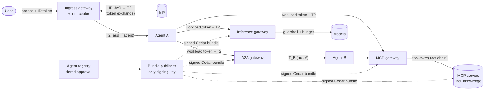

# agent-trust-fabric

[](https://github.com/parthamehta123/agent-trust-fabric/actions/workflows/ci.yml)

Identity, authorization and governance for AI agents, built from public standards: OAuth token
exchange ([RFC 8693]), JWT-bearer grants ([RFC 7523]), JWT access tokens ([RFC 9068]), the
Identity Assertion Authorization Grant (ID-JAG), MCP and A2A.

- **Ingress:** human → agent. The user's token is exchanged for a delegated, audience-bound
  token (T2) per agent.
- **Egress:** agent → tools (MCP), models (LiteLLM → Bedrock), knowledge (Bedrock KB) and other
  agents (A2A). Every hop gets its own delegated token naming the full actor chain (`act`).
- **Control plane:** an agent registry with tiered, two-person approval, compiled into a
  **signed Cedar policy bundle** that every gateway enforces before acting.

> **Status:** Phases 0–6 are complete. Everything runs and is tested locally: a hardened
> 15-container stack over TLS. The AWS deployment is fully written as OpenTofu and validated
> without touching AWS. **Nothing is deployed yet.** The sandbox apply is a separate, gated step
> (see the [runbook](docs/runbooks/sandbox.md)), and the open real-AWS assumptions are tracked as
> A-x and ED-x items with probes ready to run.

## How it fits together



Every arrow into an egress gateway is authenticated twice: the workload token proves which agent
is calling, and the delegated token proves which user it is acting for. Every egress gateway and
the knowledge server evaluates Cedar against the **current signed bundle** before minting or
forwarding anything, so revoking an agent or a delegation edge stops in-flight chains at their next
hop. Ingress is bound by the IdP exchange itself: the user's token, the frontend client and the
agent's audience.

## What it demonstrates

| Area | How |
|---|---|
| **Delegation without amplification** | user ∩ agent ∩ tool scope narrowing at every hop; A → B chains capped at two actors; an edge needs **both** sides plus security approval ([ADR-0024](docs/adr/0024-agent-to-agent-delegation.md)) |
| **Policy as signed data** | ES256 JWS bundles with a pinned key, a ≤ 10 min max age, rollback and equivocation rejected, and a dead publisher failing everything **closed** ([ADR-0022](docs/adr/0022-cedar-pdp-and-signed-bundles.md)) |
| **Retrieval-time authorization** | a server-side KB filter plus a per-chunk Cedar re-check; poisoned documents refused at ingestion ([ADR-0025](docs/adr/0025-knowledge-retrieval-authorization.md)) |
| **Egress safety** | SSRF pinning with named internal hosts, no client secrets anywhere (KMS `private_key_jwt`), response scanning, a Bedrock Guardrail pinned by version |
| **Key hygiene** | rotation and revocation windows decided deliberately: a revoked IdP key stops being trusted in ≤ 5 min ([ADR-0027](docs/adr/0027-idp-signing-key-rotation.md)) |
| **Supply chain** | digest-pinned images, SHA-pinned actions, signature-verified IaC tools, checkov sandboxed, a 14-day minimum release age, Dependabot with cooldown |
| **Infrastructure as code** | ECS Fargate behind three internal ALBs by plane, AgentCore Gateway with a Lambda interceptor, Verified Access for admin, CloudTrail data events, GitHub OIDC roles with exact subjects: all `tofu test`ed |
| **Traceability** | 27 ADRs; 55 STRIDE threats, each traced to tests; 9 accepted residual risks; 14 documented emulator divergences |

## Documents

- [Architecture](docs/architecture.md): containers, ingress and egress flows, assumptions to verify
- [Threat model](docs/threat-model.md): STRIDE per trust boundary, with mitigation IDs traced to tests
- [ADRs](docs/adr/): every decision and the reasons for it
- [Emulator divergences](docs/emulator-divergences.md): where moto, the mock IdP and others differ from the real services
- [Sandbox runbook](docs/runbooks/sandbox.md): bootstrap, apply, verification, IdP key compromise, destroy
- [Security policy](SECURITY.md)

## Layout

| Path | What |
|---|---|
| `packages/trustkit` | Provider-neutral core: JWT validation, profiles, binding, signing, exchange, cache, scanning, audit, config |
| `packages/trustkit_aws` | KMS ES256 signer, Bedrock Guardrails scanner, S3 bundle transport |
| `packages/trustkit_http` | Hardened token-endpoint and JWKS client; SSRF-pinned egress |
| `packages/trustkit_policy` | Cedar decision point and signed policy bundles |
| `policies/` | Platform-wide Cedar guardrails (CODEOWNERS-reviewed) |
| `services/interceptor` | AgentCore Gateway REQUEST/RESPONSE interceptor (Lambda) |
| `services/agent_runtime` | Reference agent runtime; authorizes from T2 only |
| `services/mcp_gateway` | MCP tool gateway: data plane and a separate admin plane |
| `services/inference_gateway` | Model gateway embedding the LiteLLM SDK |
| `services/agent_registry` | Agent registry with tiered approval, plus the bundle publisher |
| `services/a2a_gateway` | Agent-to-agent gateway: delegated tokens, Cedar `delegate`, Agent Cards |
| `services/knowledge_server` | Knowledge base (an MCP server): ingestion, retrieval-time authorization, Bedrock KB adapter |
| `infra/modules`, `infra/envs/dev` | OpenTofu for AWS (16 modules), each with `tofu test` |
| `infra/bootstrap` | One-time stack: remote state, GitHub OIDC provider, plan/apply/ingest roles |
| `.github/workflows` | `ci` (7 required checks), `plan` (read-only role), `apply` (manual, reviewed environment) |
| `tests/` | Unit and security tests, compose e2e (`tests/compose`), opt-in AWS probes (`tests/aws_probes`) |
| `packages/mock_idp`, `packages/gateway_emulator`, `packages/mock_mcp`, `packages/mock_llm` | Test-only stand-ins for the IdP, AgentCore Gateway, a tool server and a model server |
| `packages/devstack`, `deploy/local`, `compose.yaml`, `Makefile` | Hardened local stack: ephemeral CA, keys and config |

## Roadmap

| Phase | Scope | Status |
|---|---|---|
| 0 | Repo guardrails, architecture, threat model, ADRs | ✅ |
| 1 | Identity spine: JWT validation, ID-JAG/T2 exchange, cache, profiles, mock IdP, interceptor | ✅ |
| 2 | Ingress end to end: gateway harness, agent runtime, audit | ✅ |
| 3 | Egress: LiteLLM inference gateway, MCP tool gateway | ✅ |
| 4 | Agent registry, approval workflow, Cedar, signed bundles, A2A delegation | ✅ |
| 5 | Knowledge base with retrieval-time authorization | ✅ |
| 6 | OpenTofu for AWS, verified IaC toolchain, CI with OIDC, CloudTrail, runbook | ✅ written and validated; **sandbox apply pending** |

## Development

Requires [uv](https://docs.astral.sh/uv/), Python 3.12 and Docker.

```bash
uv sync
uv run ruff check . && uv run ruff format --check .
uv run mypy
uv run pytest            # about 1,700 tests; compose and AWS suites are opt-in
uvx pre-commit install
```

### Local stack (Docker)

```bash
make up         # ephemeral CA, certs, wheels, images; starts and waits for health
make e2e        # HTTPS end-to-end suite; trusts only the ephemeral CA
make logs-scan  # fails if any container log holds token- or key-shaped material
make down       # stop; `make clean` also deletes .local-ca/ and build/
```

Published ports, all on `127.0.0.1`:

| Port | Service |
|---|---|
| 8443 | Ingress gateway |
| 8444 | MCP gateway (data plane) |
| 8445 | Inference gateway |
| 8446 | A2A gateway (agent → agent) |
| 9443 | Test IdP |
| 9445 | MCP admin plane |
| 9446 | Agent registry (admin) |

The agent runtimes, tool servers, model server, bundle publisher and DynamoDB Local are reachable
only over internal networks; agent-beta's runtime only through the A2A gateway.

### Infrastructure (no AWS access needed)

```bash
make iac-tools     # build the signature-verified tflint and checkov images
make iac-validate  # fmt, validate, tofu test (every module + dev + bootstrap), tflint, checkov
```

`make iac-plan` and `make iac-apply` exist for CI. They refuse to run without
`ATF_ALLOW_AWS=1` and web-identity credentials.

[RFC 8693]: https://www.rfc-editor.org/rfc/rfc8693
[RFC 7523]: https://www.rfc-editor.org/rfc/rfc7523
[RFC 9068]: https://www.rfc-editor.org/rfc/rfc9068
