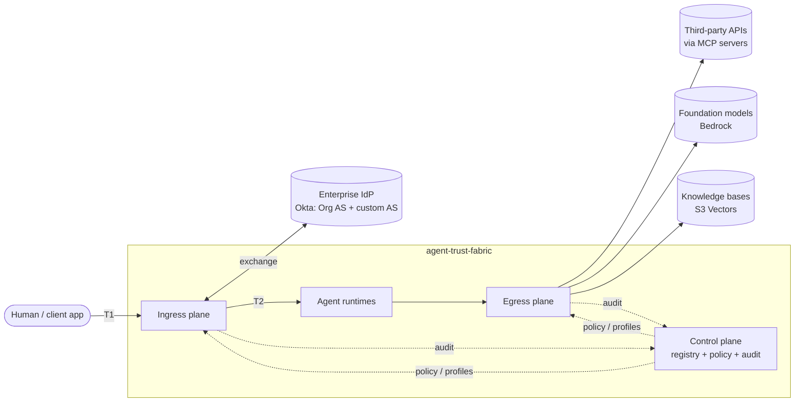
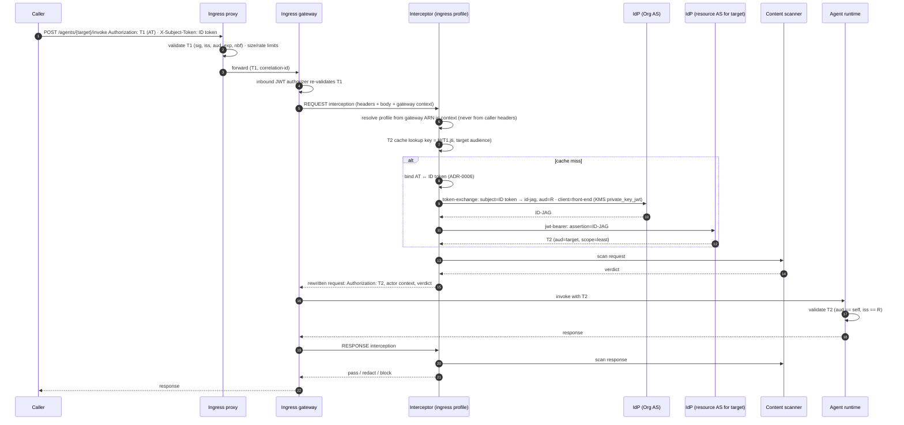
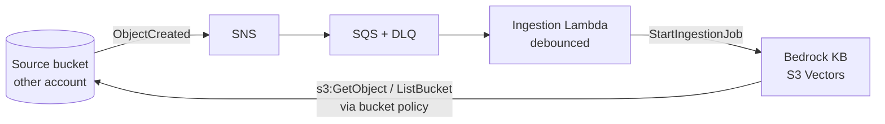

# Architecture

> Status: **Draft v0.1 (Phase 0)**. Every decision in this document is either recorded in an
> ADR under [`docs/adr/`](adr/) or listed under [Open questions](#open-questions).

## 1. Purpose

agent-trust-fabric is the identity, authorization and governance plane for AI agents.
It covers three things:

- **Ingress:** how a human (or an upstream system) invokes an agent.
- **Egress:** how an agent reaches tools, models and knowledge.
- **Control:** what each agent is permitted to do, who approved that, and the evidence.

Design goals, in priority order:

1. **Per-hop least privilege.** No component holds a credential broader than the single
   audience it is talking to.
2. **Fail closed.** Ambiguity is treated as a deny.
3. **One exchange point per boundary.** Each security-critical transformation has exactly
   one implementation.
4. **Every decision is attributable.** The audit trail answers *who* (human), *through which
   agent*, *to which target*, *under which policy*, and *with which scan verdict*.
5. **Provider-neutral core.** `trustkit` must not depend on AWS or Okta SDKs. Adapters do.

## 2. Glossary

| Term | Meaning |
|---|---|
| **T1** | The caller's token from the enterprise IdP (Okta). It is broad and user-scoped. It never leaves the ingress trust boundary. |
| **ID-JAG** | Identity Assertion JWT Authorization Grant ([draft-ietf-oauth-identity-assertion-authz-grant]). The IdP issues it in exchange for T1 via [RFC 8693] token exchange. It asserts "this user, via this client, for that resource AS". |
| **T2** | An access token that a **resource authorization server** mints from an ID-JAG via the [RFC 7523] JWT-bearer grant. It is scoped to exactly one target. |
| **Gateway profile** | Per-gateway (and per-target) configuration that tells the interceptor how to behave: flow direction, exchange on/off, IdP settings, scanner mode. |
| **Interceptor** | A Lambda attached to managed gateways at the REQUEST and RESPONSE points. One deployment serves many gateways through profiles. |
| **Content scanner** | A pluggable prompt/response inspection service: Bedrock Guardrails, a local rules engine, or a third-party product. |
| **Agent record** | The security identity of an agent in the registry: owner, trust tier, risk class, allowed and prohibited actions, egress allowances, delegation rights, approval state. |

## 3. System context

## 4. Containers

| Container | Runtime | Responsibility | Phase |
|---|---|---|---|
| `trustkit` | library | JWT validation, ID-JAG/T2 exchange client, T2 cache, profile parsing, audit events, fail-closed helpers | 1 |
| `mocks/idp` | container | Local OIDC AS. Issues T1, performs token exchange to ID-JAG and the JWT-bearer grant to T2, publishes JWKS. Uses real RS256 signing. | 1 |
| `services/interceptor` | Lambda | Multi-profile REQUEST/RESPONSE interception. It is the **sole** T1 → ID-JAG → T2 exchange point. It also runs content scanning and stamps actor identity. | 1–2 |
| `services/ingress_proxy` | Fargate | Edge concerns: T1 pre-validation, request size limits, rate limiting, correlation IDs. Forwards to the ingress gateway. **Does not exchange tokens.** | 2 |
| Ingress gateway | AgentCore Gateway (managed) | Inbound JWT authorizer, interceptor attachment, routing to runtimes | 2 / 6 |
| `services/inference_gateway` | LiteLLM on Fargate | The model egress chokepoint: per-agent virtual keys, budgets, model allowlists, audit callbacks. Bedrock is reached through the gateway's IAM role. | 3 |
| Tool gateway | AgentCore Gateway (managed) | MCP tool targets and semantic tool search. Per-target outbound credentials. | 3 / 6 |
| `services/mcp_gateway` | FastAPI on Fargate | MCP routing for agents **not** on AgentCore: enrollment, registry, discovery cache, JSON-RPC proxy, health | 3 |
| Knowledge gateway | AgentCore Gateway + KB connector | Retrieval with **retrieval-time authorization** (metadata filters derived from the caller's identity) | 5 |
| `services/agent_registry` | FastAPI + DynamoDB | Agent records, draft → review → approved workflow, Cedar policy bundles, A2A agent-card publication | 4 |
| Audit sink | CloudWatch → S3 (object lock) | Append-only decision log | 2 / 6 |

## 5. Ingress flow: human → agent

Decisions: [ADR-0002](adr/0002-single-token-exchange-point.md) (single exchange point),
[ADR-0003](adr/0003-t2-cache-policy.md) (T2 cache), [ADR-0004](adr/0004-scanner-fail-mode.md)
(scanner fail mode).

**What changes compared with a naive design**

- T1 is validated **twice** (proxy and gateway). It is exchanged **once** (interceptor).
- The profile is selected from **platform-supplied context**. A caller-controlled header
  (`Host` or similar) is never used, because that would let a caller pick a weaker profile.
- The runtime validates T2 itself. It does not trust the gateway blindly.

## 6. Egress flows: agent → tools, models, knowledge

There are three egress paths. They are separate because their credential models differ.

| Path | Agent → gateway auth | Gateway → target auth | Notes |
|---|---|---|---|
| Tools (MCP) | Workload identity token (agent's own client credentials) **or** T2-derived delegated token | Per-target exchange or a per-target API key from Secrets Manager. **No passthrough.** | See OQ-3 |
| Inference | IAM SigV4 (the agent's execution role) | Gateway role → LiteLLM → Bedrock | LiteLLM enforces the per-agent model allowlist and budget |
| Knowledge | IAM SigV4 | Gateway role → KB connector, with a retrieval filter from the agent record and the user's entitlements | Phase 5 |

The non-AgentCore path (`mcp_gateway`) provides the same guarantees for agents that run elsewhere:

| Endpoint | Behaviour |
|---|---|
| `POST /v1/servers` | Enroll an MCP server. Credentials go to Secrets Manager, never to DynamoDB. |
| `POST /v1/servers/{id}/refresh` | Re-run discovery. Results are cached as a tool snapshot with a content hash. |
| `POST /mcp` | JSON-RPC 2.0 proxy (`initialize`, `tools/list`, `tools/call`). Calls are routed to the enrolled server that owns the tool and authorized against the agent record. |

## 7. Knowledge ingestion

The source account grants the KB service role read access through its **bucket policy**.
There is no cross-account AssumeRole, so the bucket owner keeps the revoke switch.
Classification metadata is attached at ingestion so that retrieval-time filtering is possible.

## 8. Multi-profile interceptor

One interceptor deployment serves N gateways. Its profiles:

- are loaded from configuration (SSM Parameter Store for non-secret settings, Secrets
  Manager or KMS for key material);
- are keyed by **gateway ID**;
- are validated against a strict schema at cold start.

Parsing rules (fail-closed semantics):

| Condition | Behaviour |
|---|---|
| Top-level config missing or unparseable | Interceptor denies **all** requests and emits `config.invalid` |
| One profile invalid | That profile is dropped and its gateway is denied. Other profiles keep working. |
| Request from an unknown gateway ID | Deny |
| `token_exchange_enabled = false` | Allowed **only** for profiles whose target validates T1 directly. The deny-or-forward decision is explicit in the profile. Silent passthrough is not an option. |

The interceptor's IAM role can read only the parameters and secrets that its declared profiles
reference. The Terraform generates that policy from the profile list.

## 9. Local-first emulation

See [ADR-0005](adr/0005-local-first-emulation.md).

| Real | Local stand-in |
|---|---|
| Okta Org AS + custom AS | `mocks/idp`: spec-conformant token exchange + JWT-bearer, RS256, JWKS |
| AgentCore Gateway + interceptor hook | Thin local gateway harness that invokes the interceptor handler with the same event shape |
| SSM / Secrets Manager / DynamoDB / S3 / SQS | `moto` in unit and contract tests; LocalStack in the e2e compose stack |
| Bedrock models | LiteLLM `mock_response` / a fake provider |
| Content scanner | Rule-based local scanner implementing the same interface |

## Open questions

Each question becomes an ADR once it is decided.

- ~~**OQ-1**~~ → resolved by [ADR-0006](adr/0006-ingress-subject-token-binding.md). **Subject token type for ID-JAG.** The ID-JAG draft expects an **ID token** (or
  SAML assertion / refresh token) as `subject_token`, not an access token. If the caller only
  presents an access token, then either the client must also send its ID token, or we use a
  different grant. This determines the ingress API contract.
- ~~**OQ-2**~~ → resolved by [ADR-0007](adr/0007-per-agent-client-kms-signing.md) (pending A-4). **Which OAuth client requests the ID-JAG?** Options: one client per agent (workload
  identity per agent; `client_id` in T2 identifies the agent), or one interceptor client for
  everything (simpler, but T2 can't tell agents apart). Related: should client authentication
  use **`private_key_jwt` signed by KMS**, so the private key never leaves KMS?
- ~~**OQ-3**~~ → resolved by [ADR-0008](adr/0008-delegated-tool-tokens.md). **Tool egress credential model.** Per the MCP authorization spec, passing the user's
  token through to a downstream tool is prohibited. For user-delegated tool calls, do we
  exchange per tool target (the agent acts on behalf of the user, carrying an `act` claim), or
  do tools only ever see the agent's own workload identity?
- **OQ-4 · Is the ingress proxy needed?** The managed gateway already has a JWT authorizer.
  The proxy earns its place only if we need edge controls the gateway lacks: WAF, mTLS, custom
  rate limits, request normalization.
- **OQ-5 · Proof of transit.** How does a runtime prove that a request came through the gateway
  and interceptor? Options: T2 audience check only, a gateway-signed attestation header, or
  IAM-only reachability.

## Assumptions to verify against current AWS and Okta docs

These are not yet confirmed.

- ~~A-1~~ → verified against AWS docs, see [ADR-0012](adr/0012-interceptor-contract-and-failure-semantics.md).
  Headers require `passRequestHeaders: true`. An interceptor-returned `Authorization` overrides
  the target's credentials. The gateway ARN arrives in the Lambda client context. There are two
  payload shapes (`mcp` and `http`, base64).
- A-2: Okta supports the `urn:ietf:params:oauth:token-type:id-jag` requested token type for our
  tenant tier (Cross App Access), and custom authorization servers accept the JWT-bearer grant
  with an Okta-issued ID-JAG.
- A-3: Bedrock KB with an S3 Vectors store supports metadata filtering sufficient for
  retrieval-time authorization.
- ~~A-4~~ → resolved by [ADR-0009](adr/0009-ingress-id-jag-requested-by-frontend-client.md).
  The front-end client requests the ID-JAG on ingress, so we don't depend on the IdP relaxing
  the rule.
- A-1b: Real captured interceptor events (both shapes) match our fixtures (ADR-0012).
- A-5: Whether an interceptor can remove an allowlisted client header, or only override it.
  We assume override only, so reserved headers are always overwritten (ADR-0012).
- A-6: Gateway behaviour when the interceptor errors or times out is undocumented. The
  interceptor never raises and always returns an explicit deny (ADR-0012).

[RFC 8693]: https://www.rfc-editor.org/rfc/rfc8693
[RFC 7523]: https://www.rfc-editor.org/rfc/rfc7523
[draft-ietf-oauth-identity-assertion-authz-grant]: https://datatracker.ietf.org/doc/draft-ietf-oauth-identity-assertion-authz-grant/
