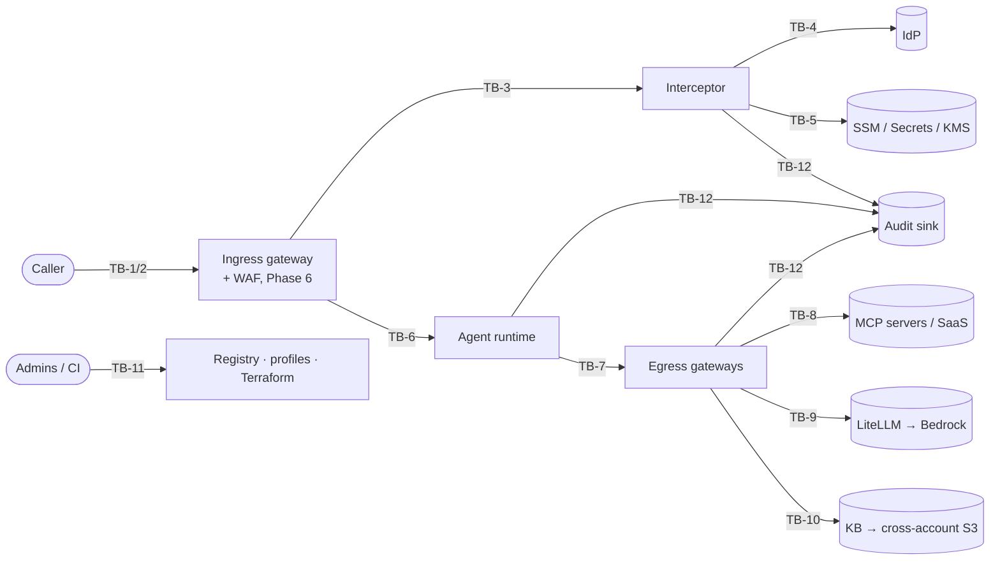

# Threat Model

> Status: **Draft v0.1 (Phase 0), awaiting review.** Method: STRIDE per trust boundary, plus
> agent-specific threats (confused deputy, prompt injection, tool poisoning) that STRIDE
> under-describes.
>
> **Traceability rule:** every mitigation has an ID (`TM-<area>-<nn>`). The test that proves it
> is marked `@pytest.mark.security`, and its docstring cites the ID. A mitigation without a test
> has status `planned`, not `done`.

## 1. Assets

| ID | Asset | Why it matters |
|---|---|---|
| AS-1 | T1 (caller's IdP token) | Broad. A thief can impersonate the user to every app that trusts it. |
| AS-2 | ID-JAG | Redeemable for T2 at one resource AS until it expires |
| AS-3 | T2 | Grants access to one target as the user |
| AS-4 | OAuth client key material (per agent / interceptor) | With it, an attacker can request ID-JAGs, i.e. mint delegated access |
| AS-5 | Gateway profiles and policy bundles | Changing them changes who can do what |
| AS-6 | Prompts, responses, tool payloads | May contain PII or confidential data |
| AS-7 | Knowledge-base corpus and embeddings | Confidential documents. Embeddings can leak content. |
| AS-8 | Agent records (registry) | Define trust tier and allowed actions |
| AS-9 | Audit log | Evidence. Tampering defeats every other control after the fact. |
| AS-10 | Third-party credentials for MCP servers (API keys) | Direct access to SaaS systems |

## 2. Actors

| ID | Actor | Capability assumed |
|---|---|---|
| TA-1 | External attacker | Network access to public endpoints. May hold a stolen T1. |
| TA-2 | Malicious or curious authenticated user | Valid T1. Crafts requests and headers. |
| TA-3 | **Compromised agent** (prompt-injected or malicious code) | Runs inside a runtime. Holds whatever credentials that runtime holds. |
| TA-4 | Compromised or malicious MCP server / tool | Returns crafted tool descriptions and results |
| TA-5 | Malicious insider (agent owner / developer) | Can submit agent records, Terraform and code changes |
| TA-6 | Compromised dependency / CI | Supply-chain code execution |

## 3. Trust boundaries

## 4. Threats and mitigations

Status values: `planned` · `in-progress` · `done (test: <id>)` · `accepted (ADR-n)`.

### TB-1 / TB-2: Caller → ingress gateway (no separate proxy, OQ-4 closed)

| ID | STRIDE | Threat | Mitigation | Phase | Status |
|---|---|---|---|---|---|
| TM-ING-01 | S | Forged or unsigned T1 (`alg=none`, HS256 confusion with the public key used as secret) | Allowlist `alg` (RS256/ES256 only). Key from JWKS by `kid`. Reject any header `jku`/`x5u`. | 1 | done (test: `tests/unit/test_jwt.py::TestAlgorithmAttacks, TestStructuralEdges`) |
| TM-ING-02 | S | Token for another app replayed here | Exact `iss` and `aud` match. Required `exp`, `iat`, `nbf` with ≤60 s skew. | 1 | done (test: `tests/unit/test_jwt.py::TestClaimAttacks`) |
| TM-ING-03 | S | JWKS endpoint spoofing / key injection / retired-key reuse | JWKS URL pinned in config (HTTPS only). `jku`/`x5u`/`jwk`/`x5c`/`crit` headers rejected. Unknown-`kid` refresh rate-limited; a signature failure on a known `kid` (rotation under the same `kid`) gets one refresh and one re-verify from the **same** budget (ADR-0027). Proactive refresh (`max_key_age_s` **5 min**, ADR-0027) so revoked keys age out; RR-9. Cached keys dropped after 24 h without a successful fetch. Duplicate `kid`s, `oct`/private/`enc`/weak (<2048-bit RSA) keys ignored. | 1 | done (test: `tests/unit/test_jwt.py::TestKeySelectionAttacks, TestJwksKeyResolver, TestJwksEntryEdges, TestKeyRotationUnderSameKid`) |
| TM-ING-04 | T | Caller selects a weaker gateway profile via `Host` or a custom header | Profile resolved **only** from `GATEWAY_ARN` in the Lambda client context. A missing value means deny. Caller headers are never consulted (ADR-0012). | 1 | done (test: `tests/interceptor/test_handler.py::TestIngressDeny`, `tests/interceptor/test_events.py::TestContext`) |
| TM-ING-05 | D | Oversized or high-rate requests exhaust the interceptor or IdP quota | Size limits at the gateway/WAF (Phase 6) and runtime (done). Per-subject rate limit. The T2 cache (ADR-0003) cuts IdP calls. IdP 429 → deny with `Retry-After`. | 2 | planned |
| TM-ING-06 | I | T1 leaks to the runtime or to logs | Interceptor replaces `Authorization` with T2 and strips T1 from every forwarded header. Log redaction filter. A test asserts that T1 bytes never appear downstream or in captured logs. | 1 | done (test: `TestIngressAllow::test_caller_credentials_never_forwarded`, repr/log-safety tests across trustkit) |
| TM-ING-08 | S | Caller pairs their access token with someone else's ID token (or a stale one) to mint delegated tokens as another user | AT ↔ ID-token binding: same `iss`/`sub`, ID-token `aud`/`azp` matches the AT client, client in the profile's `ingress_clients`, required `auth_time` within `max_auth_age_s` (ADR-0006, ADR-0009) | 1 | done (test: `tests/unit/test_binding.py`) |
| TM-ING-07 | R | User denies having made a request | Audit event per request: `sub`, `client_id`, target, profile, decision, scan verdict, `jti` hashes, correlation ID | 2 | done (test: `TestIngressAllow::test_audit_event`, `TestNeverRaises::test_audit_failure_denies`); sink → CloudWatch in Phase 6 |

### TB-3 / TB-4 / TB-5: Interceptor ↔ IdP, config and secrets

| ID | STRIDE | Threat | Mitigation | Phase | Status |
|---|---|---|---|---|---|
| TM-EXC-01 | S | Stolen client secret used to mint ID-JAGs | Per-agent `private_key_jwt` signed via `kms:Sign`, so the key is non-exportable. Assertion `exp` ≤ 60 s, unique `jti` (ADR-0007). | 1 | done (test: `tests/unit/test_signing.py`, `tests/aws/test_kms_signer.py`, `tests/exchange/test_exchange.py::TestEdgePaths`) |
| TM-EXC-02 | E | T2 broader than needed (wildcard scopes or audience) | Scopes and audience come from the profile, never from the request. T2 is validated after minting: `aud` == target, scopes ⊆ profile scopes, else deny. | 1 | done (test: `tests/exchange/test_exchange.py::TestResponseValidation`) |
| TM-EXC-03 | S | Cached T2 served to the wrong user or target | Cache key = H(T1 `jti` ‖ `sub` ‖ target audience). Never keyed by `sub` alone. TTL = min(exp − 30 s, 300 s). Per-execution-environment memory only. | 1 | done (test: `tests/unit/test_cache.py`, `tests/exchange/test_exchange.py::TestCaching`) |
| TM-EXC-04 | E | Revoked user keeps access through the cache | Bounded by the ≤300 s TTL (accepted residual, ADR-0003). T1 expiry is checked on every request, even on a cache hit. | 1 | done (test: `tests/exchange/test_exchange.py::TestCaching::test_entry_expires_before_t2`); residual RR-1 |
| TM-EXC-05 | T | Malformed profile config yields permissive behaviour | Strict schema (unknown keys rejected). Top-level parse failure → deny-all. Per-profile failure → that gateway denied. Covered by property-based tests. | 1 | done (test: `tests/unit/test_profiles.py::TestTopLevelFailsClosed, TestPerProfileRejection, TestParserDifferentials`) |
| TM-EXC-06 | E | Interceptor role reads secrets for other systems | IAM policy generated from the declared profiles: exact parameter and secret ARNs, no wildcards | 6 | planned |
| TM-EXC-07 | D | IdP outage → total outage | Fail closed (availability trade-off accepted). Cache softens short blips. Circuit breaker with fast deny. | 1 | done (test: `tests/unit/test_breaker.py`, `tests/exchange/test_exchange.py::TestCircuitBreaker`, `test_idp_outage_trips_breaker`) |
| TM-EXC-08 | S | ID-JAG replayed | Short `exp` (IdP-controlled). Resource AS enforces `jti` single use. The mock IdP implements this so tests can prove it. | 1 | done (test: `tests/mock_idp/test_conformance.py` replay cases; fresh assertion per retry in `TestRetries`) |

### TB-6: Gateway → agent runtime

| ID | STRIDE | Threat | Mitigation | Phase | Status |
|---|---|---|---|---|---|
| TM-RT-01 | S | Request reaches the runtime bypassing the gateway and interceptor | Runtime validates T2 (`aud` == self, `iss` == resource AS). Network reachability restricted. See OQ-5 (proof of transit). | 2 | done (test: `tests/unit/test_resource.py`, `tests/e2e/test_runtime.py`, `tests/e2e/test_ingress_e2e.py::TestBypassAttempts`); A-7 (AgentCore Runtime inbound authorizer) to verify |
| TM-RT-02 | T | Interceptor-added actor context forged by the caller | Omitting a header does **not** strip it (A-5), so the interceptor overwrites every reserved `x-atf-*` header on every path. The runtime trusts T2 claims, not headers. Credential headers are never allowlisted (ADR-0012). | 1 | done (interceptor overwrites + runtime trusts T2 only: `tests/e2e/test_runtime.py::TestRuntimeRejects`, `test_forged_advisory_headers_overwritten_end_to_end`); A-5 to verify |
| TM-INT-01 | D/E | Interceptor crash or timeout with undocumented gateway semantics (A-6) becomes fail-open | The handler never raises. Every failure returns an explicit `transformedGatewayResponse` deny, with an internal deadline below the Lambda timeout (ADR-0012). | 1 | done (test: `tests/interceptor/test_handler.py::TestNeverRaises`, deadline test); A-6 to verify |
| TM-INT-03 | S/E | A principal invokes the interceptor Lambda directly with a forged client context (`GATEWAY_ARN`), selecting a profile and obtaining a T2 | Only the gateway role holds `lambda:InvokeFunction` on it; a `check` refuses `lambda:*` in every task and function policy; the caller still needs a valid user token and ID token for the pinned frontend client. Every invocation is a CloudTrail data event (ADR-0026 §27), so a non-gateway caller is detectable. Account-wide enforcement (SCP or permission boundary) is outside this repo. | 6 | done in IaC (`infra/envs/dev/tests`: `nobody_invokes_lambda_but_the_gateway`, `check.only_gateway_invokes_interceptor`) |
| TM-INT-04 | T | The interceptor binds to the wrong gateway because its id is configured out of band (SSM, ADR-0026 §22) | Exact match is unchanged; the parameter is Terraform-managed (drift visible); malformed, unreadable or ambiguous (more than one profile) means deny-all | 6 | done (`tests/interceptor/test_lambda_main.py::TestGatewayIdParameter`) |
| TM-INT-02 | E | RESPONSE interceptor (which still runs after an MCP short-circuit) turns a request-time deny into a pass | The response path never upgrades a deny. Deny marking can't be forged (ADR-0012). | 1 | done (test: `TestResponsePath::test_monotonic`, `test_mcp_response_after_our_own_deny_stays_denied`) |

### TB-7 / TB-8: Agent → tool egress, MCP

| ID | STRIDE | Threat | Mitigation | Phase | Status |
|---|---|---|---|---|---|
| TM-TOOL-01 | E | **Confused deputy**: a prompt-injected agent invokes a tool the user may not use, or uses the agent's broader privilege | Tool call authorized against (agent record ∩ user entitlement) by Cedar policy at the gateway, not inside the agent | 3–4 | done: token-flow binding guard (`tests/exchange/test_egress.py`), plus `guardrail:user-scopes` over T2's IdP-downscoped scopes, enforced at the interceptor, MCP gateway and inference gateway (`tests/interceptor/test_egress_handler.py::TestEgressPolicy`, `tests/mcp_gateway/test_bundle_policy.py`, `tests/exchange/test_entitlements.py`) |
| TM-TOOL-02 | S | **Token passthrough**: user's token forwarded to a third-party MCP server | Prohibited (MCP authorization spec). Per-target RFC 8693 exchange with `act`, or a per-target credential when `delegation = none` (ADR-0008). | 3 | done (delegated per-target tokens, no passthrough: `test_agent_and_user_tokens_never_forwarded`); `delegation = none` path in 3b |
| TM-TOOL-08 | E | A cached delegated token outlives a narrowed grant (bundle reduces an agent's scopes; cache returns the broader token) | Delegated-token cache key includes the requested scopes (ADR-0023 §8) | 4 | done (`tests/exchange/test_egress.py::TestDelegatedExchangeRejects::test_narrowed_grant_never_served_from_cache`) |
| TM-TOOL-07 | E | Agent-to-agent delegation chains amplify privilege | Chains capped at two actors (binding, IdP and Cedar), loops refused, both-sides `delegate` edges only, every actor must hold the grant itself (ADR-0024). | 3–4 | done (`tests/exchange/test_chains.py`, `tests/policy/test_chains.py`) |
| TM-TOOL-03 | T | **Tool poisoning**: MCP server changes tool descriptions after approval (rug pull) | Discovery snapshot hashed at approval. A hash change puts the server in `pending_review` and its tools are hidden until re-approved. | 3 | done (digest pinning + drift quarantine + per-call recheck: `tests/mcp_gateway/test_snapshot.py`, `test_admin.py::TestLifecycle`, `test_proxy.py::TestDenies`); residual RR-4 |
| TM-TOOL-04 | I | Tool result carries injected instructions or exfiltration payloads | RESPONSE-side content scan on tool results. Size caps. Egress allowlist for URLs the agent can reach. | 3 | done (response scanning + local rules; production adapter `trustkit_aws.guardrails.BedrockGuardrailScanner`, ADR-0019 §6) |
| TM-TOOL-05 | I | MCP server credentials leak via the registry | Credentials only in Secrets Manager. DynamoDB stores the ARN. The API never returns secrets. | 3 | done for the core (store holds Secrets Manager ARN only; values never in records, logs or agent responses: `test_admin.py`, `test_proxy.py`); Secrets Manager adapter in 3b HTTP step |
| TM-TOOL-06 | S | SSRF via enrolled server URL (e.g. `169.254.169.254`, internal hosts) | URL allowlist: HTTPS only, DNS resolved and checked against private/link-local ranges at enroll **and** call time (DNS rebinding) | 3 | done (vet + pin IP per call, IPv4-mapped/NAT64/6to4 decoding, no redirects: `tests/mcp_gateway/test_ssrf.py`) |

### TB-9: Inference egress

| ID | STRIDE | Threat | Mitigation | Phase | Status |
|---|---|---|---|---|---|
| TM-INF-01 | E | Agent uses unapproved or expensive models | Inference gateway (ADR-0019) enforces per-agent model grants from the signed policy bundle (ADR-0023) plus Cedar `call_model` before any provider call, and clamps `max_tokens`. In AWS, the gateway role may invoke only the allowlisted model ARNs. | 3 | done in the gateway (`tests/inference/test_inference.py::TestService::test_model_not_allowed_before_any_call`, `test_max_tokens_defaults_and_clamps`); IAM model-ARN scoping in Phase 6 |
| TM-INF-02 | D | Runaway agent loop burns budget | Per-agent daily token budget: DynamoDB conditional `ADD` reserve, then settle to actual usage. A provider error releases the reservation. Store unavailable → deny. | 3 | done (`TestInMemoryBudget::test_concurrent_reservations_never_overspend`, `TestDynamoBudget`, `TestService::test_budget_*`, `TestEdgeCases::test_unreachable_store_is_unavailable`); RPM limits and spend alerts in Phase 6 |
| TM-INF-03 | I | Sensitive data sent to the model | Prompt scanned before any spend; completion scanned before return (BLOCK → 502, REDACT → masked text). Production scanner: Bedrock Guardrails `ApplyGuardrail`; any intervention other than anonymised PII is BLOCK, unknown policy shapes fail closed. | 3 | done (`TestService::test_prompt_injection_blocked_before_spend`, `test_completion_*`, `TestGuardrails`, `TestGuardrailRealisticShapes`); Guardrails verified via Stubber only (ED-10) |

### TB-10: Knowledge retrieval

| ID | STRIDE | Threat | Mitigation | Phase | Status |
|---|---|---|---|---|---|
| TM-KB-01 | I | Agent retrieves documents above the user's or its own clearance | Filter built server-side from user collections (IdP-downscoped `kb.<c>.read`) ∩ every actor's grant, with the lowest ceiling; every chunk re-checked in Cedar `read_document`; filter anomalies dropped and audited; agents supply only `query`/`top_k` (ADR-0025) | 5 | done (`tests/policy/test_knowledge_policy.py`, `tests/knowledge/test_retrieval.py`, compose `tests/compose/test_knowledge_e2e.py`) |
| TM-KB-02 | T | Poisoned documents injected into the corpus | Owner manifests bounded by the collection's ceiling; unlabelled or unknown collections refused; injection- and secret-shaped content refused before indexing (scanner failure = refuse); provenance per chunk; the CLI writes nothing if any document is rejected; poisoned chunks that slip through are withheld at retrieval | 5 | done (`tests/knowledge/test_ingest.py`, `test_retrieval.py::test_poisoned_chunk_withheld_others_returned`) |
| TM-KB-03 | E | KB role reads beyond the intended prefix | The Bedrock KB role may only `GetObject` under `corpus/` and `ListBucket` with that prefix, query or write the one vector index, and invoke the one embedding model; its trust is limited to this account's knowledge bases (`aws:SourceAccount`/`SourceArn`) | 6 | done in IaC (`infra/modules/knowledge_base/tests`) |
| TM-KB-04 | T | Something other than the ingest pipeline writes the corpus, bypassing manifests and the scanner | The bucket policy denies Put/Delete to every principal except `kb-ingest`; `kb-ingest` is assumable only by listed roles and can write only `corpus/`; every write is an EventBridge event | 6 | done in IaC (`infra/modules/knowledge_base/tests`) |

### Token binding (all hops)

| ID | STRIDE | Threat | Mitigation | Phase | Status |
|---|---|---|---|---|---|
| TM-TOK-01 | S/E | A stolen bearer token (workload, T2, tool or T_B) is replayed from elsewhere within its lifetime | Today: 5-min lifetimes, strict audience per hop, internal networks, no tokens in logs (CI gate). Decided (ADR-0028): DPoP binds the workload token to an in-memory agent key, so a stolen workload+T2 pair is useless without it; stateless HMAC nonce plus per-instance `jti` cache against replay; per-profile `require_dpop` rollout. Tool hops stay bearer if Okta can't bind token-exchange output (A-12, RR-10). | 7 | **Phase 1 done; local stack runs `required` end to end** (`tests/unit/test_dpop.py`, `tests/mcp_gateway/test_dpop_app.py`, `tests/exchange/test_egress.py::TestDpopBoundWorkloadToken`, compose `tests/compose/test_dpop_e2e.py`); Phase 2 pending A-12 |

### TB-11: Control plane

| ID | STRIDE | Threat | Mitigation | Phase | Status |
|---|---|---|---|---|---|
| TM-A2A-01 | E | **Privilege laundering**: an agent without a grant asks a granted agent to act for it | No amplification: every actor in the chain must be allowed `invoke_tool` for the same server and scopes, re-checked against the current bundle on every hop (ADR-0024 §3) | 4 | done (`tests/policy/test_chains.py::TestNoAmplification`) |
| TM-A2A-02 | E | Unbounded or looping delegation chains | Two-actor cap in `bind_actor`, the IdP and Cedar; an agent appearing twice in its own chain is refused; `act` parsed strictly (unknown members, nulls, depth bombs) | 4 | done (`tests/exchange/test_chains.py`) |
| TM-A2A-03 | I | Agent estate reconnaissance through Agent Cards | A card is served only to an agent permitted to delegate to it; the card URL is the gateway's, never the runtime's | 4 | done (`tests/policy/test_chains.py::TestCards`, `tests/a2a/test_broker.py::TestCards`, `tests/a2a/test_app.py::TestCards`) |
| TM-A2A-04 | E | A unilateral or unreviewed trust edge | `delegate` permits only when both records name each other; any version that adds an edge needs security approval | 4 | done (`TestEdges`, `tests/registry/test_workflow.py::TestDelegationEdges`) |
| TM-A2A-05 | S | An agent runtime accepts a delegated token naming an actor it never agreed to (previously, runtimes ignored `act` entirely) | `ResourceAuthorizer` refuses any `act` unless the runtime opts in. Opted-in runtimes accept exactly one well-formed prior actor, and only when Cedar `delegate` actor -> self holds on the current bundle (403 otherwise). | 4 | done (`tests/e2e/test_runtime_delegation.py`) |
| TM-A2A-06 | E | The A2A gateway mints a token or forwards before policy, or without an audit record | Order: bundle → target card → `delegate` → user entitlement → request scan → audit (failure → 503) → exchange → SSRF-pinned forward → response scan; denials mint nothing (`tests/a2a/test_broker.py::TestDenies`, `test_audit_failure_means_nothing_minted_or_forwarded`) | 4 | done |
| TM-CP-01 | E | Agent owner self-approves elevated trust | Draft → review → approved workflow (ADR-0021). The author never approves and no person counts twice; elevated and privileged need owner-team + security approval; in-review versions are frozen; privileged approvals expire after 90 days; conditional writes stop lost approvals; audit before write. | 4 | done in the registry (`tests/registry/test_workflow.py::TestApproval`, `TestAuditAndRaces`, `tests/registry/test_store.py`); gateways consume it via signed bundles in 4b |
| TM-CP-05 | I | Registry reveals which agents exist to unrelated teams (enumeration) | Unreadable and missing agents both answer `not_found`; reads limited to the owner team, approvers and security. | 4 | done (`TestRead::test_outsider_cannot_tell_existing_from_missing`) |
| TM-CP-06 | E | Agent moved to another team by a draft to escape its owners' review | A new version needs the current owner team; a transfer needs both teams; a draft can't change team. | 4 | done (`TestDrafts::test_ownership_transfer_needs_both_teams`, `test_edit_cannot_move_team`) |
| TM-CP-07 | T | Forged, replayed, rolled-back or equivocating policy bundle grants an agent access | ES256 JWS verified against a key pinned in gateway config; strict header (no `jku`/`x5u`/`jwk`/`crit`); strictly increasing `bundle_version` (rollback and equivocation rejected); maximum age of 10 minutes, then deny; only the publisher holds the signing key; invalid policies are refused at publish and at load. | 4 | done: library and all three gateways (`tests/policy/test_bundle.py`, `tests/policy/test_runtime.py`, `tests/registry/test_publish.py`) |
| TM-CI-01 | I | A pull-request job (whose workflow file the PR itself can change) uses the plan role to read workload data | Plan role trusts only this repository's `pull_request` and `main` subjects (never forks); ReadOnlyAccess is paired with explicit denies on object reads outside state, table items, secret values, invocations and retrievals; it may write only `*.tflock` (ADR-0026 §26) | 6 | done in IaC (`infra/bootstrap/tests`: `plan_reads_no_workload_data`) |
| TM-CI-02 | E | The apply role (admin) disables audit, widens its own trust, or acts outside the sandbox | Assumable only from the `sandbox` environment with a required reviewer; explicit denies on org/account/billing, IAM users and keys, stopping or deleting CloudTrail, the trail's log bucket, the state bucket's protections, every CI role and the OIDC provider, and regions outside the allowlist | 6 | done in IaC (`apply_guardrails`); account-wide SCPs remain outside this repo |
| TM-CI-03 | S | Another repository, a fork or another branch obtains a CI role | Exact `sub` and `aud` equality, no `StringLike`, no wildcards; ingest has its own environment, so its subject differs from apply's | 6 | done in IaC (`exact_subjects_per_role`) |
| TM-CP-02 | T | Unreviewed Terraform changes profiles or policies | CODEOWNERS on `infra/` and `docs/adr/`. Branch protection. Plan output reviewed in the PR. | 6 | in progress: CODEOWNERS on `infra/`; `make iac-validate` (OpenTofu tests encoding the security invariants, tflint, checkov) on every change; plan review in CI comes in 6d |
| TM-CP-03 | T | Supply-chain compromise (deps, actions) | Locked deps (`uv.lock`), hash-pinned image installs, `pip-audit`, SBOM, CI actions pinned by commit SHA, digest-pinned base images, Dependabot (pip/uv, actions, docker) with a 14-day cooldown; `uv` pinned for laptops and CI; base images signature-verified or ≥ 14 days old (`image-policy`, ADR-0026 §29; report-only until 2026-10-25) | 0 | done (CI config; `tests/unit/test_workflows.py`, `tests/unit/test_image_policy.py`) |
| TM-CP-04 | I | Secrets committed to git | `gitleaks` + `detect-private-key` pre-commit + CI secret scan | 0 | in-progress |

### TB-12: Audit

| ID | STRIDE | Threat | Mitigation | Phase | Status |
|---|---|---|---|---|---|
| TM-AUD-01 | R/T | Audit records deleted or altered | Separate log account / bucket with S3 Object Lock (compliance mode). Writers have put-only access. | 6 | planned |
| TM-AUD-02 | I | Audit log becomes a token or PII store | Schema forbids token bodies (only `jti` hashes). Payloads are referenced, not embedded. | 2 | done (test: `tests/unit/test_audit.py`) |

## 5. Accepted residual risks

| ID | Risk | Rationale | ADR |
|---|---|---|---|
| RR-1 | Up to 300 s of continued access after user revocation (T2 cache) | IdP load and latency versus revocation lag. Bounded and documented. | ADR-0003 |
| RR-2 | Scanner outage blocks agents whose profile is fail-closed | Security over availability by default. Per-profile fail-open opt-in is audited. | ADR-0004 |
| RR-4 | An approved MCP server changes *behaviour* without changing its tool descriptions or schemas, which digest pinning cannot see | Pinning catches every model-visible change. Behavioural changes are bounded by per-call tool-result scanning (TM-TOOL-04), delegated tokens scoped to user ∩ agent ∩ tool, and audit. | ADR-0017 |
| RR-5 | `cedarpy` wheels carry no PyPI provenance attestation, so the native policy engine can't be cryptographically tied to a source commit | Quarantine vetting (hashes, RECORD, Apache-2.0 licence, embedded SBOM of 133 permissive crates), hash-pinned lock, pip-audit, and decision tests covering every shipped policy. Revisit when attestations appear, or build from source in Phase 6. | ADR-0022 |
| RR-6 | An attacker who can write bundle storage **and** suppress the publisher can keep a gateway that has not yet fetched a newer bundle on the last one it saw (e.g. pre-revocation), because rollback protection only rejects versions older than what that gateway has seen | Bounded by the bundle max age (10 min; then everything is denied). S3 write limited to the publisher role, bucket versioning and object lock (Phase 6), lazy refresh on the request path (a gateway checks for a newer bundle before deciding), rollback and equivocation audited. Demonstrated end to end in `tests/compose/test_registry_e2e.py::TestLifecycle::test_rollback_attack_rejected`. | ADR-0022, ADR-0023 |
| RR-7 | Tool servers share the `tools-admin` network with the MCP admin plane (needed for discovery), so a compromised tool server can reach the admin listener | The admin API still requires an admin-AS token (`mcp.admin` scope) and two-person approval, and the data plane shares no network with it. Phase 6: a security group restricts the admin listener's ingress to the admin VPC and SSO proxy, and discovery egress goes through a dedicated path. Observed in compose e2e (not asserted as isolated). | ADR-0018, ADR-0025, **closed in the AWS design by ADR-0026 §10** (admin ALB reachable only from Verified Access; asserted in `infra/envs/dev/tests`). It remains a property of the local compose stack. |
| RR-8 | Every checkov release pins `asteval==1.0.6` (sandbox escape to code execution on attacker-controlled expressions, GHSA-9w56-46f6-3qhx) | checkov runs in our own hash-pinned image with `--network none`, read-only root and repo mount, `cap_drop ALL`, non-root, no credentials; in CI only in a job with no cloud permissions. Its attempted call to `api0.prismacloud.io` was observed being blocked. Revisit when checkov unpins asteval. | ADR-0026 |
| RR-9 | A signing key the IdP has revoked (e.g. after compromise) is still trusted by validators until their cached key set is older than `max_key_age_s`: tokens signed with it carry a *known* `kid`, so nothing in the request path forces a refresh | Bounded at **5 min** plus one request (was 1 h), at about 12 JWKS fetches per hour per validator per issuer. Closed to deployment time by the runbook's key-compromise procedure (forced rolling restart). Eliminating it entirely would need the IdP to push revocations, which OIDC doesn't standardise. | ADR-0027 |
| RR-10 | Bearer tokens: until an agent opts in and its plane runs `required`, a stolen workload token is usable within its lifetime (≤ 5 min) at its audience. With Phase 1 in force: process-memory compromise of an agent yields its DPoP key; cross-instance replay is possible within one nonce epoch; third-party tool hops stay bearer | Short lifetimes, audience per hop, internal networks, log scanning; Phase 1 binds the agent's egress | ADR-0028 |
| RR-3 | Local emulation may diverge from real AgentCore, KMS and Okta behaviour | Assumptions A-1..A-3 in `architecture.md` and every known divergence in [`emulator-divergences.md`](emulator-divergences.md) (ED-1..ED-4 so far) are verified against real services before Phase 6 | ADR-0005, ADR-0010 |

## 6. Review log

| Date | Reviewer | Notes |
|---|---|---|
| 2026-10-10 | — | Initial draft |
| 2026-10-11 | Partha Mehta | Accepted ADR-0006/7/8. Added TM-ING-08 and TM-TOOL-07. |
| 2026-10-19 | Partha Mehta | ADR-0028 (design accepted): sender-constrained tokens. Bearer tokens are the main remaining gap (TM-TOK-01, RR-10). DPoP binds the workload token (Okta-supported for client credentials); stateless HMAC nonce; egress first; A-12..A-14 to verify. |
| 2026-10-19 | Partha Mehta | Hardening follow-ups: `uv` pinned everywhere; base-image policy (signed or ≥ 14 days; found two pins on `main` adopted too young; report-only until 2026-10-25); registry refuses non-routable Agent Card endpoints with the gateway's own URL rules; KB ingest removes withdrawn documents (empty corpus refused). |
| 2026-10-18 | Partha Mehta | ADR-0027: IdP key rotation and revocation. Found via PR #8 (a recreated mock IdP reused `kid`s with new keys, so validators saw `BAD_SIGNATURE` and never refetched). Rotation under the same `kid` now recovers in one shared-budget refresh; proactive refresh 1 h to 5 min; RR-9 added; mock IdP `kid`s are RFC 7638 thumbprints; runbook key-compromise procedure. |
| 2026-10-14 | Partha Mehta | Phase 6d (ADR-0026 §25-28): CI validates IaC with the same pinned tools as local; OIDC bootstrap (plan role read-only with explicit data-read denies; apply role only from the reviewed `sandbox` environment, admin minus guardrail denies; ingest one hop to kb-ingest); CloudTrail with targeted data events and undeletable logs; plan/apply workflows with no stored keys or third-party credential actions; sandbox runbook and opt-in AWS probes. Found: real phase ordering (images and IdP client keys need a targeted first apply), and plan files were not gitignored. TM-CI-01..03 added. Nothing applied to AWS. |
| 2026-10-14 | Partha Mehta | Phase 6c (ADR-0026 §12-24): service runtime config rendered in IaC (Okta by convention, inline JSON, PEM-pinned bundle key, no client secrets); named internal egress hosts (§19, found because AWS targets are private); Bedrock Guardrail (pinned version), KB on S3 Vectors with a gated corpus bucket, interceptor Lambda plus AgentCore Gateway (REQUEST+RESPONSE, headers passed, credential headers refused). Corrected my own §15 draft against ADR-0012/0013. TM-INT-03/04 and TM-KB-04 added; TM-KB-03 done. 69 tofu tests, tflint clean, checkov 546/0. Nothing applied to AWS. |
| 2026-10-13 | Partha Mehta | Phase 6b: ECS Fargate services (one role, one SG, digest-only images, no exec), three internal ALBs by plane, Verified Access (Cedar) in front of the admin plane, closing RR-7 in the AWS design. `sign_grants` is the single source for IAM and KMS key policies. 35 tofu tests, tflint clean, checkov 466/0. Nothing applied to AWS. |
| 2026-10-13 | Partha Mehta | Phase 6a (ADR-0026): verified IaC toolchain (OpenTofu signature-verified; tflint rebuilt from its signed release after the official image failed byte-identity; checkov built from hash-pinned requirements and sandboxed, RR-8). Foundations as OpenTofu: private-only VPC with endpoints and flow logs, KMS (the publisher alone may sign bundles), DynamoDB (PITR, CMK, deletion protection), locked-down bundle bucket, budget. 16 tofu tests, tflint clean, checkov 76/0. Nothing applied to AWS. |
| 2026-10-13 | Partha Mehta | Phase 5 complete (5b): knowledge server in compose behind the MCP gateway with its own AS; tool-token authority allowlist (no cross-tool replay); least-privilege narrowing to the user's scopes at both tool paths; ingestion is part of `make up` (a poisoned corpus fails the build). Compose e2e 64/64, twice on one stack. RR-7 recorded (tool servers can reach the MCP admin listener on `tools-admin`). |
| 2026-10-13 | Partha Mehta | Phase 5a (ADR-0025): knowledge server (an MCP server behind the MCP gateway), collections plus classification ceiling, server-side filter plus per-chunk Cedar re-check, ingestion with bounded manifests and scan-before-index, Bedrock KB adapter (ED-13). Corrected during review: ingestion first refused PII-bearing documents (now allowed and masked at retrieval, as decided). TM-KB-01/02 done in the library. |
| 2026-10-13 | Partha Mehta | Phase 4 complete (4c-ii-b): agent-beta runtime and A2A gateway in compose. A real user → alpha → beta → tool chain works; the tool independently verifies nested `act` and names both agents. Compose e2e 53/53, twice on one stack: laundering, edge withdrawal (both sides), revocation, an unentitled user, least-disclosure cards, isolation. Found: the SSRF guard refused a single-label runtime hostname (correct; FQDN alias added); agent-beta was reachable from the inference gateway through the shared IdP network (now on a dedicated `idp-beta`). |
| 2026-10-13 | Partha Mehta | Phase 4c-ii-a: A2A gateway (`message/send`, least-disclosure cards, audit before minting), runtime-side `act` validation (closes TM-A2A-05: runtimes previously ignored `act`), a minimal tool-using agent B, chain-aware MCP gateway and interceptor, SSRF pinning shared in `trustkit_http`. Compose e2e still 40/40. |
| 2026-10-13 | Partha Mehta | Phase 4c-i (ADR-0024): two-actor delegation chains (nested `act`), Cedar `delegate`, no amplification, edge approval by security, Agent Cards in the bundle. Found and fixed: a chain loop accepted under misconfiguration (now refused); duplicate Agent entities made `delegate` error (now fixed, and it failed closed). TM-TOOL-07 updated; TM-A2A-01..04 added. |
| 2026-10-13 | Partha Mehta | Phase 4b-ii-b: registry API and bundle publisher in compose (publisher on its DynamoDB network only, the only holder of the signing key; gateways mount bundles read-only). Compose e2e 40/40, twice on one stack: two-person approval over HTTPS, revocation reaching both gateways in seconds, rollback replay rejected and audited, publisher death leading to fail-closed and then recovery, unentitled user denied by the guardrail, isolation of the new containers. The interceptor now mounts only its own key. RR-6 recorded (replay window before a gateway sees a newer bundle). |
| 2026-10-13 | Partha Mehta | Phase 4b-ii-a (ADR-0023): all three gateways enforce the signed bundle and Cedar; interim `agents` maps removed; user entitlements via IdP-downscoped T2 scopes; per-model budgets; most-restrictive fail mode. TM-TOOL-01 done end to end; TM-TOOL-08 found and fixed (cache key). |
| 2026-10-13 | Partha Mehta | Phase 4b-i (ADR-0022): `trustkit-policy` (in-process Cedar, generated permits plus repo guardrails, signed bundles, verifier, holder), file and S3 transports, separate bundle publisher with a DynamoDB version counter. `cedarpy` vetted in quarantine; RR-5 added. TM-CP-07 added. |
| 2026-10-13 | Partha Mehta | Phase 4 framing: in-process Cedar, signed policy bundles, three tiers, two-actor delegation chains. Phase 4a (ADR-0021): agent registry with tiered, server-enforced approval. TM-CP-01 done; TM-CP-05 and TM-CP-06 added and done. |
| 2026-10-12 | Partha Mehta | Phase 3 complete (ADR-0020): the inference gateway runs in compose with its own AS audience, local-only `api_base` model routes, and its own DynamoDB network. Compose e2e 24/24 covers audience isolation, model allowlist, prompt and completion blocking (the model is never called for a blocked prompt), budget settlement in DynamoDB, and network isolation with positive controls. Pinned subnets moved out of Docker's default pools. ED-11 added. |
| 2026-10-12 | Partha Mehta | Phase 3c (ADR-0019): inference gateway with the LiteLLM SDK (no hidden egress, tested in a fresh interpreter), workload-token auth, per-agent model allowlist, DynamoDB budget reservations, Bedrock Guardrails scanner. TM-INF-01/02/03 and TM-TOOL-04 done. ED-10 added. |
| 2026-10-12 | Partha Mehta | Phase 3b complete: MCP gateway in containers (DynamoDB Local, separate admin plane sharing no network with the data plane). Compose e2e 14/14 over TLS incl. two-person approval, delegated-token verification by the tool, SSRF refusal, and rug-pull quarantine. Logs clean. |
| 2026-10-12 | Partha Mehta | Phase 3b core (ADR-0017): MCP gateway with SSRF pinning, tool-digest pinning, two-person approval, credential modes. TM-TOOL-03/05/06 done. RR-4 added. |
| 2026-10-12 | Partha Mehta | Review fixes R1-R5 (event-loop blocking, bounded histories, scanner thread cap, SHA-pinned CI, doc drift). OQ-4 closed. Phase 3a (ADR-0016): delegated tool tokens; TM-TOOL-01/02/07 done for the token flow. |
| 2026-10-12 | Partha Mehta | Phase 2b: hardened container stack (ADR-0015). Compose e2e 9/9 over TLS. Container logs scanned: no token or key material. Per-service images contain only their own first-party wheels. |
| 2026-10-11 | Partha Mehta | Phase 2a: runtime T2 authz (OQ-5, ADR-0014), circuit breaker, header-allowlist policy, gateway emulator, in-process e2e. TM-RT-01/02 and TM-EXC-07 done. |
| 2026-10-11 | Partha Mehta | Phase 1 complete: interceptor (ADR-0012/0013), scanning, audit. 8 more mitigations done or advanced. Audit failure → deny. |
| 2026-10-11 | Partha Mehta | A-1 verified against AWS docs (ADR-0012). Added TM-INT-01/02. TM-RT-02 rewritten: omission ≠ removal. |
| 2026-10-11 | Partha Mehta | Phase 1 checkpoint 5: exchange + T2 cache + hardened HTTP adapter (ADR-0011). TM-EXC-01/02/03/04/08 done; TM-EXC-07 retry part done. |
| 2026-10-11 | Partha Mehta | Phase 1 checkpoint 4: mock IdP (independent of trustkit; strict A-4; client-assertion and ID-JAG replay protection), 50 conformance tests. |
| 2026-10-11 | Partha Mehta | Phase 1 checkpoint 3: ES256 `private_key_jwt` signer + KMS adapter (ADR-0010). Four moto divergences logged (ED-1..4). |
| 2026-10-11 | Partha Mehta | Phase 1 checkpoint 2: ADR-0009 accepted (front-end client requests the ID-JAG on ingress; `auth_time` freshness). TM-ING-08 done. |
| 2026-10-11 | Partha Mehta | Phase 1 checkpoint 1: TM-ING-01/02/03 and TM-EXC-05 done. Decisions: `enabled=false` is a kill switch (deny), KMS key ARNs only (no aliases), JWKS max staleness 24 h. |
