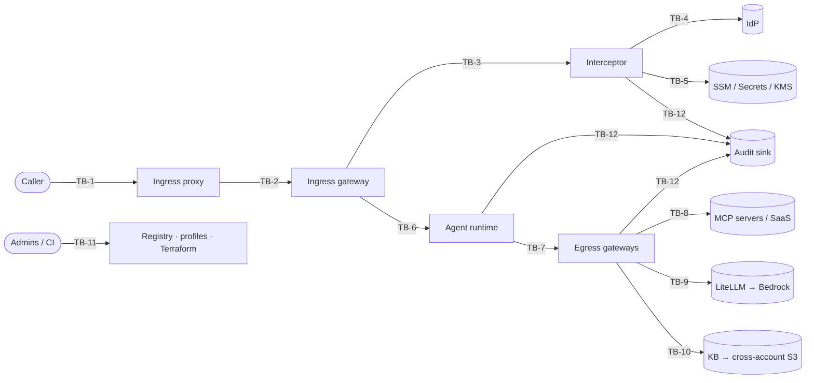

# Threat Model

> Status: **Draft v0.1 (Phase 0), awaiting review.** Method: STRIDE per trust boundary, plus
> agent-specific threats (confused deputy, prompt injection, tool poisoning) that STRIDE
> under-describes.
>
> **Traceability rule:** every mitigation has an ID (`TM-<area>-<nn>`). The test that proves it
> is marked `@pytest.mark.security`, and its docstring cites the ID. A mitigation without a test
> has status `planned`, not `done`.

## 1. Assets

| ID | Asset | Why it matters |
|---|---|---|
| AS-1 | T1 (caller's IdP token) | Broad. A thief can impersonate the user to every app that trusts it. |
| AS-2 | ID-JAG | Redeemable for T2 at one resource AS until it expires |
| AS-3 | T2 | Grants access to one target as the user |
| AS-4 | OAuth client key material (per agent / interceptor) | With it, an attacker can request ID-JAGs, i.e. mint delegated access |
| AS-5 | Gateway profiles and policy bundles | Changing them changes who can do what |
| AS-6 | Prompts, responses, tool payloads | May contain PII or confidential data |
| AS-7 | Knowledge-base corpus and embeddings | Confidential documents. Embeddings can leak content. |
| AS-8 | Agent records (registry) | Define trust tier and allowed actions |
| AS-9 | Audit log | Evidence. Tampering defeats every other control after the fact. |
| AS-10 | Third-party credentials for MCP servers (API keys) | Direct access to SaaS systems |

## 2. Actors

| ID | Actor | Capability assumed |
|---|---|---|
| TA-1 | External attacker | Network access to public endpoints. May hold a stolen T1. |
| TA-2 | Malicious or curious authenticated user | Valid T1. Crafts requests and headers. |
| TA-3 | **Compromised agent** (prompt-injected or malicious code) | Runs inside a runtime. Holds whatever credentials that runtime holds. |
| TA-4 | Compromised or malicious MCP server / tool | Returns crafted tool descriptions and results |
| TA-5 | Malicious insider (agent owner / developer) | Can submit agent records, Terraform and code changes |
| TA-6 | Compromised dependency / CI | Supply-chain code execution |

## 3. Trust boundaries

## 4. Threats and mitigations

Status values: `planned` · `in-progress` · `done (test: <id>)` · `accepted (ADR-n)`.

### TB-1 / TB-2: Caller → ingress proxy → gateway

| ID | STRIDE | Threat | Mitigation | Phase | Status |
|---|---|---|---|---|---|
| TM-ING-01 | S | Forged or unsigned T1 (`alg=none`, HS256 confusion with the public key used as secret) | Allowlist `alg` (RS256/ES256 only). Key from JWKS by `kid`. Reject any header `jku`/`x5u`. | 1 | done (test: `tests/unit/test_jwt.py::TestAlgorithmAttacks, TestStructuralEdges`) |
| TM-ING-02 | S | Token for another app replayed here | Exact `iss` and `aud` match. Required `exp`, `iat`, `nbf` with ≤60 s skew. | 1 | done (test: `tests/unit/test_jwt.py::TestClaimAttacks`) |
| TM-ING-03 | S | JWKS endpoint spoofing / key injection / retired-key reuse | JWKS URL pinned in config (HTTPS only). `jku`/`x5u`/`jwk`/`x5c`/`crit` headers rejected. Unknown-`kid` refresh rate-limited. Proactive refresh (`max_key_age_s` 1 h) so retired keys age out. Cached keys dropped after 24 h without a successful fetch. Duplicate `kid`s, `oct`/private/`enc`/weak (<2048-bit RSA) keys ignored. | 1 | done (test: `tests/unit/test_jwt.py::TestKeySelectionAttacks, TestJwksKeyResolver, TestJwksEntryEdges`) |
| TM-ING-04 | T | Caller selects a weaker gateway profile via `Host` or a custom header | Profile resolved **only** from platform context (gateway ARN). Caller headers are ignored for routing decisions. | 1 | planned |
| TM-ING-05 | D | Oversized or high-rate requests exhaust the interceptor or IdP quota | Size limits at the proxy. Per-subject rate limit. The T2 cache (ADR-0003) cuts IdP calls. IdP 429 → deny with `Retry-After`. | 2 | planned |
| TM-ING-06 | I | T1 leaks to the runtime or to logs | Interceptor replaces `Authorization` with T2 and strips T1 from every forwarded header. Log redaction filter. A test asserts that T1 bytes never appear downstream or in captured logs. | 1 | planned |
| TM-ING-08 | S | Caller pairs their access token with someone else's ID token (or a stale one) to mint delegated tokens as another user | AT ↔ ID-token binding: same `iss`/`sub`, ID-token `aud`/`azp` matches the AT client, client in the profile's `ingress_clients`, required `auth_time` within `max_auth_age_s` (ADR-0006, ADR-0009) | 1 | done (test: `tests/unit/test_binding.py`) |
| TM-ING-07 | R | User denies having made a request | Audit event per request: `sub`, `client_id`, target, profile, decision, scan verdict, `jti` hashes, correlation ID | 2 | planned |

### TB-3 / TB-4 / TB-5: Interceptor ↔ IdP, config and secrets

| ID | STRIDE | Threat | Mitigation | Phase | Status |
|---|---|---|---|---|---|
| TM-EXC-01 | S | Stolen client secret used to mint ID-JAGs | Per-agent `private_key_jwt` signed via `kms:Sign`, so the key is non-exportable. Assertion `exp` ≤ 60 s, unique `jti` (ADR-0007). | 1 | in-progress (signer done: `tests/unit/test_signing.py`, `tests/aws/test_kms_signer.py`; used by exchange next) |
| TM-EXC-02 | E | T2 broader than needed (wildcard scopes or audience) | Scopes and audience come from the profile, never from the request. T2 is validated after minting: `aud` == target, scopes ⊆ profile scopes, else deny. | 1 | planned |
| TM-EXC-03 | S | Cached T2 served to the wrong user or target | Cache key = H(T1 `jti` ‖ `sub` ‖ target audience). Never keyed by `sub` alone. TTL = min(exp − 30 s, 300 s). Per-execution-environment memory only. | 1 | planned |
| TM-EXC-04 | E | Revoked user keeps access through the cache | Bounded by the ≤300 s TTL (accepted residual, ADR-0003). T1 expiry is checked on every request, even on a cache hit. | 1 | planned |
| TM-EXC-05 | T | Malformed profile config yields permissive behaviour | Strict schema (unknown keys rejected). Top-level parse failure → deny-all. Per-profile failure → that gateway denied. Covered by property-based tests. | 1 | done (test: `tests/unit/test_profiles.py::TestTopLevelFailsClosed, TestPerProfileRejection, TestParserDifferentials`) |
| TM-EXC-06 | E | Interceptor role reads secrets for other systems | IAM policy generated from the declared profiles: exact parameter and secret ARNs, no wildcards | 6 | planned |
| TM-EXC-07 | D | IdP outage → total outage | Fail closed (availability trade-off accepted). Cache softens short blips. Circuit breaker with fast deny. | 1 | planned |
| TM-EXC-08 | S | ID-JAG replayed | Short `exp` (IdP-controlled). Resource AS enforces `jti` single use. The mock IdP implements this so tests can prove it. | 1 | in-progress (enforced by mock IdP: `tests/mock_idp/test_conformance.py`; client-side handling in exchange next) |

### TB-6: Gateway → agent runtime

| ID | STRIDE | Threat | Mitigation | Phase | Status |
|---|---|---|---|---|---|
| TM-RT-01 | S | Request reaches the runtime bypassing the gateway and interceptor | Runtime validates T2 (`aud` == self, `iss` == resource AS). Network reachability restricted. See OQ-5 (proof of transit). | 2 | planned |
| TM-RT-02 | T | Interceptor-added actor context forged by the caller | The interceptor strips every inbound header in the reserved `x-atf-*` namespace before adding its own | 1 | planned |

### TB-7 / TB-8: Agent → tool egress, MCP

| ID | STRIDE | Threat | Mitigation | Phase | Status |
|---|---|---|---|---|---|
| TM-TOOL-01 | E | **Confused deputy**: a prompt-injected agent invokes a tool the user may not use, or uses the agent's broader privilege | Tool call authorized against (agent record ∩ user entitlement) by Cedar policy at the gateway, not inside the agent | 3–4 | planned |
| TM-TOOL-02 | S | **Token passthrough**: user's token forwarded to a third-party MCP server | Prohibited (MCP authorization spec). Per-target RFC 8693 exchange with `act`, or a per-target credential when `delegation = none` (ADR-0008). | 3 | planned |
| TM-TOOL-07 | E | Agent-to-agent delegation chains amplify privilege | Delegated tool tokens carry `act` with max depth 1. Nested `act` is denied unless both agent records allow delegation (ADR-0008). | 3–4 | planned |
| TM-TOOL-03 | T | **Tool poisoning**: MCP server changes tool descriptions after approval (rug pull) | Discovery snapshot hashed at approval. A hash change puts the server in `pending_review` and its tools are hidden until re-approved. | 3 | planned |
| TM-TOOL-04 | I | Tool result carries injected instructions or exfiltration payloads | RESPONSE-side content scan on tool results. Size caps. Egress allowlist for URLs the agent can reach. | 3 | planned |
| TM-TOOL-05 | I | MCP server credentials leak via the registry | Credentials only in Secrets Manager. DynamoDB stores the ARN. The API never returns secrets. | 3 | planned |
| TM-TOOL-06 | S | SSRF via enrolled server URL (e.g. `169.254.169.254`, internal hosts) | URL allowlist: HTTPS only, DNS resolved and checked against private/link-local ranges at enroll **and** call time (DNS rebinding) | 3 | planned |

### TB-9: Inference egress

| ID | STRIDE | Threat | Mitigation | Phase | Status |
|---|---|---|---|---|---|
| TM-INF-01 | E | Agent uses unapproved or expensive models | LiteLLM per-agent model allowlist from the agent record. The Bedrock IAM policy is limited to the allowlisted model ARNs. | 3 | planned |
| TM-INF-02 | D | Runaway agent loop burns budget | Per-agent budget and RPM limits in LiteLLM. Alert at thresholds. | 3 | planned |
| TM-INF-03 | I | Sensitive data sent to the model | Request-side scan / guardrail with PII redaction at the inference gateway | 3 | planned |

### TB-10: Knowledge retrieval

| ID | STRIDE | Threat | Mitigation | Phase | Status |
|---|---|---|---|---|---|
| TM-KB-01 | I | Agent retrieves documents above the user's or its own clearance | Retrieval-time metadata filter built server-side from (agent record ∩ user entitlements). The agent cannot supply or widen the filter. | 5 | planned |
| TM-KB-02 | T | Poisoned documents injected into the corpus | Source-bucket write access restricted. Ingestion records provenance. Classification is required, and unclassified documents are not indexed. | 5 | planned |
| TM-KB-03 | E | KB role reads beyond the intended prefix | Bucket policy limits the KB role to specific prefixes. No AssumeRole into the source account. | 5 | planned |

### TB-11: Control plane

| ID | STRIDE | Threat | Mitigation | Phase | Status |
|---|---|---|---|---|---|
| TM-CP-01 | E | Agent owner self-approves elevated trust | Draft → review → approved workflow. Approver ≠ submitter, enforced server-side. Elevated tiers need security approval. | 4 | planned |
| TM-CP-02 | T | Unreviewed Terraform changes profiles or policies | CODEOWNERS on `infra/` and `docs/adr/`. Branch protection. Plan output reviewed in the PR. | 6 | planned |
| TM-CP-03 | T | Supply-chain compromise (deps, actions) | Locked deps (`uv.lock`), `pip-audit`, SBOM, actions pinned by SHA (TODO), Dependabot | 0 | in-progress |
| TM-CP-04 | I | Secrets committed to git | `gitleaks` + `detect-private-key` pre-commit + CI secret scan | 0 | in-progress |

### TB-12: Audit

| ID | STRIDE | Threat | Mitigation | Phase | Status |
|---|---|---|---|---|---|
| TM-AUD-01 | R/T | Audit records deleted or altered | Separate log account / bucket with S3 Object Lock (compliance mode). Writers have put-only access. | 6 | planned |
| TM-AUD-02 | I | Audit log becomes a token or PII store | Schema forbids token bodies (only `jti` hashes). Payloads are referenced, not embedded. | 2 | planned |

## 5. Accepted residual risks

| ID | Risk | Rationale | ADR |
|---|---|---|---|
| RR-1 | Up to 300 s of continued access after user revocation (T2 cache) | IdP load and latency versus revocation lag. Bounded and documented. | ADR-0003 |
| RR-2 | Scanner outage blocks agents whose profile is fail-closed | Security over availability by default. Per-profile fail-open opt-in is audited. | ADR-0004 |
| RR-3 | Local emulation may diverge from real AgentCore, KMS and Okta behaviour | Assumptions A-1..A-3 in `architecture.md` and every known divergence in [`emulator-divergences.md`](emulator-divergences.md) (ED-1..ED-4 so far) are verified against real services before Phase 6 | ADR-0005, ADR-0010 |

## 6. Review log

| Date | Reviewer | Notes |
|---|---|---|
| 2026-10-10 | — | Initial draft |
| 2026-10-11 | Partha Mehta | Accepted ADR-0006/7/8. Added TM-ING-08 and TM-TOOL-07. |
| 2026-10-11 | Partha Mehta | Phase 1 checkpoint 4: mock IdP (independent of trustkit; strict A-4; client-assertion and ID-JAG replay protection), 50 conformance tests. |
| 2026-10-11 | Partha Mehta | Phase 1 checkpoint 3: ES256 `private_key_jwt` signer + KMS adapter (ADR-0010). Four moto divergences logged (ED-1..4). |
| 2026-10-11 | Partha Mehta | Phase 1 checkpoint 2: ADR-0009 accepted (front-end client requests the ID-JAG on ingress; `auth_time` freshness). TM-ING-08 done. |
| 2026-10-11 | Partha Mehta | Phase 1 checkpoint 1: TM-ING-01/02/03 and TM-EXC-05 done. Decisions: `enabled=false` is a kill switch (deny), KMS key ARNs only (no aliases), JWKS max staleness 24 h. |
